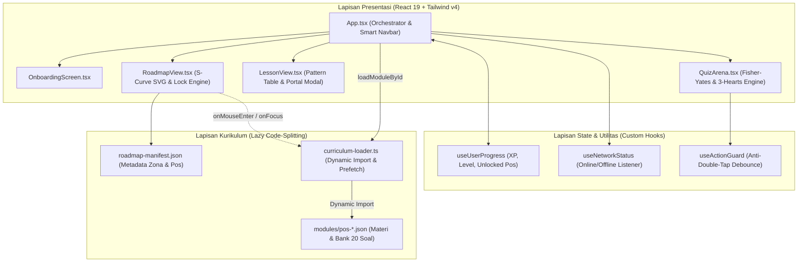

<p align="center">
  
</p>

<h1 align="center">Qalamis (قَلَمِيس)</h1>

<p align="center">
  <strong>Petualangan Belajar Tata Bahasa Arab Interaktif Berbasis Gamifikasi & Code-Splitting</strong>
</p>

<p align="center">
  <a href="https://react.dev/">
    
  </a>
  <a href="https://www.typescriptlang.org/">
    
  </a>
  <a href="https://tailwindcss.com/">
    
  </a>
  <a href="https://vite.dev/">
    
  </a>
  <a href="LICENSE">
    
  </a>
</p>

<p align="center">
  
</p>

---

**Qalamis** (*قَلَمِيس*) adalah aplikasi pembelajaran tata bahasa Arab (*Nahwu* & *Shorof*) interaktif berbasis web dengan alur gamifikasi bertahap, pemuatan modul kurikulum dinamis (*lazy code-splitting*), serta dukungan akses luring (*offline-ready*). Aplikasi ini memandu pembelajar mulai dari pengenalan *Mudzakkar* dan *Muannats* hingga perangkaian kalimat melalui peta petualangan berpola kurva-S, tabel bedah pola interaktif, dan arena evaluasi berbasis sistem **3 Hati**.

---

## 📑 Daftar Isi

- [📱 Tampilan Aplikasi (Mobile Showcase)](#-tampilan-aplikasi-mobile-showcase)
- [✨ Fitur Utama](#-fitur-utama)
- [🛠️ Tech Stack & Perkakas Kode](#️-tech-stack--perkakas-kode)
- [🏗️ Arsitektur Sistem & Struktur Direktori](#️-arsitektur-sistem--struktur-direktori)
- [🚀 Instalasi & Pengembangan Lokal](#-instalasi--pengembangan-lokal)
- [🧭 Alur Pembelajaran & Mekanika Aplikasi](#-alur-pembelajaran--mekanika-aplikasi)
- [📐 Skema Data & Kontrak Tipe](#-skema-data--kontrak-tipe)
- [🤝 Kontribusi](#-kontribusi)
- [📄 Lisensi](#-lisensi)

---

## 📱 Tampilan Aplikasi (Mobile Showcase)

### Tampilan 4 Layar Utama (Responsif)

| Onboarding | Peta Petualangan | Materi & Pola | Arena Kuis |
| :---: | :---: | :---: | :---: |
|  |  |  |  |

---

## ✨ Fitur Utama

- 🗺️ **Peta Petualangan Kurva-S (*Winding S-Curve Roadmap*)**: Visualisasi progres lintas zona menggunakan kurva *Cubic Bezier* SVG dinamis serta penguncian pos otomatis hingga pos prasyarat dituntaskan.
- 📖 **Bedah Pola & Sorotan Morfologi Arab Tanpa Putus Huruf**: Pewarnaan segmen kata (*prefix*, *base*, *focus*, *suffix*) pada elemen teks RTL kontinu agar sambungan huruf hijaiyah (*ligature*) tetap utuh dan presisi.
- 🎯 **Arena Kuis Acak Berbasis *Fisher-Yates* & Sistem 3 Hati**: Setiap sesi kuis mengacak 10 soal dari bank 20 soal sekaligus mengacak urutan opsi jawaban (A–D) dengan batas maksimal 3 kesalahan.
- ⚡ **Navigasi Melayang 60fps (*Smart Auto-Hide Navbar*)**: *Floating header* yang otomatis tersembunyi saat menggulir ke bawah dan muncul kembali saat menggulir ke atas menggunakan `requestAnimationFrame` serta transformasi GPU.
- 🔌 **Ketahanan Jaringan & *Predictive Prefetching***: Memuat modul kurikulum secara malas (*lazy-loaded*) dan melakukan *prefetch* otomatis pada pos berikutnya saat pengguna membaca materi.

---

## 🛠️ Tech Stack & Perkakas Kode

### Inti Antarmuka & Pemrograman

| Kategori | Teknologi | Versi | Peran dalam Sistem |
| :--- | :--- | :--- | :--- |
| **Library UI** | React (`react`, `react-dom`) | `^19.0.0` | Rendering komponen deklaratif, manajemen siklus hidup, dan `createPortal` untuk modal. |
| **Bahasa Pemrograman** | TypeScript | `^5.7.0` | Pengetikan statis ketat (*strict mode*) untuk kontrak data kurikulum, kuis, dan progres pengguna. |
| **Styling Engine** | Tailwind CSS | `^4.0.0` | Utilitas CSS modern dengan token desain taktil (*tactile UI*), dukungan RTL, dan animasi *keyframe*. |
| **Ikonografi** | Lucide React | `^0.475.0` | Set ikon vektor ringan dan konsisten pada navigasi, peta, materi, dan evaluasi. |

### Perkakas Build, Linting & Kualitas Kode

| Perkakas | Fungsi Teknis |
| :--- | :--- |
| **Vite** | *Bundler* dan *dev server* berbasis ESM dengan *Hot Module Replacement* (HMR) cepat serta *dynamic import* per modul kurikulum. |
| **ESLint & TypeScript ESLint** | Analisis statis kode untuk menegakkan aturan *React Hooks*, kebersihan dependensi `useEffect`, dan konsistensi tipe. |
| **PostCSS / `@tailwindcss/vite`** | Kompilasi utilitas CSS v4 tanpa *runtime overhead* dan optimasi ukuran *bundle* produksi. |

---

## 🏗️ Arsitektur Sistem & Struktur Direktori

Qalamis menerapkan **Feature-Based Modular Architecture** yang memisahkan lapisan presentasi per fitur, *custom hooks* untuk manajemen state dan perangkat keras, serta pemuatan data kurikulum berbasis manifes.

### Diagram Arsitektur Aliran Data



### Struktur Direktori Proyek

```text
qalamis/
├── docs/
│   └── screenshots/               # Tangkapan layar aplikasi ukuran mobile
├── public/                        # Aset statis, favicon.svg, ikon PWA & service worker
├── src/
│   ├── components/                # Komponen UI generik & dapat digunakan ulang
│   │   ├── CustomSelect.tsx       # Dropdown aksesibel untuk lompat antar pos terbuka
│   │   └── ui/
│   │       ├── ArabicText.tsx     # Komponen tipografi RTL (dir="rtl", lang="ar")
│   │       ├── ProgressBar.tsx    # Bilah progres terukur dengan atribut ARIA
│   │       └── QalamisLogo.tsx    # Komponen SVG logo Qalamis (icon & full)
│   ├── data/                      # Manifes kurikulum dan pemuat modul dinamis
│   │   ├── curriculum-loader.ts   # Dynamic import & cache modul berdasarkan ID
│   │   ├── roadmap-manifest.json  # Daftar zona dan metadata ringkas seluruh pos
│   │   └── modules/               # Berkas JSON materi & bank soal per pos
│   ├── features/                  # Modul fitur terisolasi (Domain-Driven UI)
│   │   ├── onboarding/
│   │   │   └── OnboardingScreen.tsx
│   │   ├── roadmap/
│   │   │   └── RoadmapView.tsx
│   │   ├── lesson/
│   │   │   └── LessonView.tsx
│   │   └── quiz/
│   │       └── QuizArena.tsx
│   ├── hooks/                     # Custom React Hooks untuk logika bisnis & browser
│   │   ├── useActionGuard.ts      # Pengaman klik ganda (280ms cooldown)
│   │   ├── useNetworkStatus.ts    # Pemantau status koneksi navigator.onLine
│   │   └── useUserProgress.ts     # Persistensi LocalStorage, kalkulasi XP & Level
│   ├── App.tsx                    # Root orchestrator, routing layar & auto-hide navbar
│   ├── index.css                  # Konfigurasi Tailwind v4, font Arab & animasi taktil
│   └── main.tsx                   # Entry point aplikasi React
├── index.html                     # Dokumen HTML utama dengan konfigurasi viewport & font
├── LICENSE                        # Berkas lisensi MIT proyek
├── package.json                   # Daftar dependensi dan skrip otomasi
└── tsconfig.json                  # Konfigurasi kompiler TypeScript
```

### Keputusan Rekayasa Utama (*Key Engineering Decisions*)

1. **Isolasi Konteks Tumpukan Modal (`React Portal`)**: Kartu komponen menggunakan properti `transform` dan `backdrop-filter` yang menciptakan *containing block* baru di peramban. Seluruh dialog konfirmasi dirender menggunakan `createPortal(..., document.body)` agar selalu terpusat secara presisi di tengah *viewport*.
2. **Keutuhan Tipografi Kursif Arab**: Penyorotan tata bahasa pada `LessonView` menggunakan elemen `<span>` sebaris tanpa *margin* atau pemisahan karakter, menjaga mesin pembentukan glif tetap menyambungkan huruf hijaiyah secara alami.
3. **Optimasi Performa Gulir 60fps**: `App.tsx` menggunakan `window.requestAnimationFrame` dengan *event listener* `{ passive: true }` dan transformasi GPU (`translate-y`) untuk menyembunyikan *floating header* tanpa memicu *layout reflow*.

---

## 🚀 Instalasi & Pengembangan Lokal

### Prasyarat Sistem

- **Node.js** versi `20.x` atau lebih baru
- **npm** versi `10.x` atau *package manager* kompatibel (`pnpm` / `yarn`)

### Langkah Instalasi

1. **Kloning repositori ke direktori lokal:**

   ```bash
   git clone [https://github.com/username/qalamis.git](https://github.com/username/qalamis.git)
   cd qalamis
   ```

2. **Pasang seluruh dependensi proyek:**

   ```bash
   npm install
   ```

3. **Jalankan server pengembangan lokal:**

   ```bash
   npm run dev
   ```

4. **Buka aplikasi pada peramban:**

   Akses alamat lokal yang ditampilkan pada terminal (secara baku di `http://localhost:5173`).

### Daftar Skrip Perintah

| Perintah | Deskripsi |
| :--- | :--- |
| `npm run dev` | Menjalankan server pengembangan Vite dengan HMR aktif. |
| `npm run build` | Melakukan pengecekan tipe TypeScript (`tsc`) dan membangun bundel produksi teroptimasi di direktori `dist/`. |
| `npm run preview` | Menjalankan pratinjau lokal dari hasil kompilasi produksi `dist/`. |
| `npm run lint` | Menjalankan pemeriksaan kualitas dan standar gaya kode menggunakan ESLint. |

---

## 🧭 Alur Pembelajaran & Mekanika Aplikasi

1. **Onboarding Karakter (`OnboardingScreen`)**: Pengguna memilih identitas gramatikal karakter (**Petualang Putra / *Mudzakkar*** atau **Petualang Putri / *Muannats***) dan memasukkan nama panggilan.
2. **Navigasi Peta (`RoadmapView`)**:
   - Sistem menghitung `unlockedModuleId` secara otomatis berdasarkan pos tertinggi yang telah lulus.
   - Pos yang belum terbuka dikunci (`aria-disabled="true"`) dan memberikan umpan balik visual getar (`animate-shake-x`) apabila diakses sebelum waktunya.
3. **Eksplorasi Materi (`LessonView`)**:
   - Menyajikan tujuan belajar, konsep ringkas, dialog kontekstual yang dapat dilipat, tabel pola interaktif dengan filter kategori, sorotan segmen kalimat, serta daftar kosakata (*mufrodat*).
4. **Evaluasi Arena Kuis (`QuizArena`)**:
   - Mengambil 10 soal acak dari `quizBank` berkapasitas 20 soal menggunakan algoritma pengacakan *Fisher-Yates*.
   - Setiap kesalahan mengurangi 1 dari **3 Hati**. Jika hati habis, sesi berakhir dan pengguna diarahkan meninjau kembali tabel pola sebelum mencoba ulang dengan kombinasi soal acak baru.

---

## 📐 Skema Data & Kontrak Tipe

<details>
<summary><strong>Klik untuk melihat definisi antarmuka TypeScript Modul & Kuis</strong></summary>

```typescript
export type SegmentRole = 'prefix' | 'base' | 'focus' | 'suffix';

export interface LessonModuleData {
  id: number;
  zoneId: string;
  slug: string;
  title: string;
  canDo: string;
  explanation: string;
  patternTable: {
    title: string;
    filters: ReadonlyArray<string>;
    headers: ReadonlyArray<string>;
    rows: ReadonlyArray<{
      id: string;
      category: string;
      cells: ReadonlyArray<string>;
      arabicResult: string;
      transliteration: string;
      meaning: string;
      breakdown: string;
    }>;
  };
  highlightedExamples: ReadonlyArray<{
    segments: ReadonlyArray<{
      text: string;
      role: SegmentRole;
      label?: string;
    }>;
    transliteration: string;
    translation: string;
  }>;
  quickTrick: string;
  vocabulary: ReadonlyArray<{
    arabic: string;
    transliteration: string;
    meaning: string;
    gender?: 'mudzakkar' | 'muannats';
  }>;
  quizBank: ReadonlyArray<QuizQuestionItem>;
}

export interface QuizQuestionItem {
  id: string;
  difficulty: 'medium' | 'hard';
  type: string;
  question: string;
  options: ReadonlyArray<string>;
  correctIndex: number;
  feedbackWrong: string;
  feedbackCorrect: string;
}
```

</details>

---

## 🤝 Kontribusi

Kontribusi pengembangan fitur, penambahan modul kurikulum baru, maupun perbaikan *bug* sangat terbuka melalui alur berikut:

1. Lakukan *fork* pada repositori ini.
2. Buat *branch* fitur baru dari `main` (`git checkout -b fitur/nama-fitur`).
3. Pastikan seluruh perubahan lolos pemeriksaan tipe (`npm run build`) dan *linter* (`npm run lint`).
4. Kirimkan *Pull Request* dengan deskripsi perubahan yang jelas dan terstruktur.

---

## 📄 Lisensi

Didistribusikan di bawah **Lisensi MIT**. Lihat berkas [`LICENSE`](LICENSE) untuk informasi hak cipta dan ketentuan penggunaan selengkapnya.